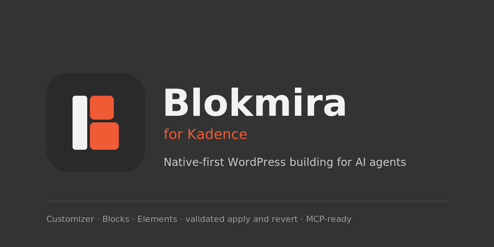

<div align="center">


# Blokmira for Kadence

**Native-first WordPress site building for AI agents**

[](https://github.com/tutsvela/blokmira/releases/latest)
[](LICENSE)
[](skills/blokmira/SKILL.md)
[](.claude-plugin/plugin.json)
[](https://wordpress.org/themes/kadence/)
[](docs/mcp-roadmap.md)
[](https://github.com/tutsvela/blokmira/actions/workflows/validate.yml)
[](CONTRIBUTING.md)

[Installation](docs/installation.md) · [Quick start](#quick-start) · [Sample prompts](prompts/) · [Scripts](#scripts) · [MCP roadmap](docs/mcp-roadmap.md) · [Changelog](CHANGELOG.md)



</div>

## Overview

Blokmira lets your AI agent build WordPress sites the way a careful Kadence developer would.

It is an [Agent Skill](https://agentskills.io) and a Claude Code plugin for the Kadence theme and blocks. Give your agent a design, a screenshot or a brief. Blokmira makes the agent:
1. check what the site actually has;
2. map the work to Kadence's own Customizer settings, blocks and Elements;
3. use custom CSS, PHP or JavaScript only after every native option is ruled out.

Global Customizer changes are planned as a validated change file. You can dry-run it, apply it with a backup and revert it exactly.

> [!NOTE]
> Blokmira is an independent project by Salman Sarwar. It is not made, endorsed or supported by Kadence, Nexcess or Liquid Web. "Kadence" names the products it works with. See [NOTICE.md](NOTICE.md).

## Features

| Feature | What it gives you |
|---|---|
| **Site check first** | Read-only scripts report the installed Kadence products, versions and Theme Kit Pro modules. They also list every block and its attributes, every Customizer setting, and any CSS that overrides the Customizer. The live site decides, so Blokmira works across Kadence versions. |
| **Design to native blocks** | Maps each section to Row Layout, Section, Advanced Text, Info Box and other Kadence blocks. Maps each visual property to the control that sets it, with notes on responsive behaviour, palette, dark mode and accessibility. |
| **Safe Customizer control** | Palette, typography, widths, buttons, Header Builder and Footer Builder are planned as `changes.json`. Every key, value shape and choice is checked against the live registry. You get a dry run first, a backup before writing and an exact revert. |
| **Deep Kadence knowledge** | About 115 requirement recipes and a map of 893 Customizer settings. Element placements and conditions, Dynamic Content and ACF, Conversions, Shop Kit and Insights. A digest of the full official Kadence documentation. Every fact is tagged `[code]`, `[runtime]`, `[docs]` or `[unverified]`. |
| **MCP-ready** | A documented operation contract (`inventory`, `schema`, `get`, `plan`, `apply`, `revert`, `palette`) is the base for the planned Blokmira WordPress plugin and MCP server. |

## Installation

### One command (npx)

Install into the current project with the open [skills CLI](https://github.com/vercel-labs/skills). It needs Node.js.

```bash
npx skills add tutsvela/blokmira
```

Add `-g` to install it for every project, or `-a claude-code` to target one agent:

```bash
npx skills add tutsvela/blokmira -g -a claude-code
```

### Other ways

| Where you use it | How to install |
|---|---|
| **Claude Code** | `/plugin marketplace add tutsvela/blokmira`, then `/plugin install blokmira@blokmira` |
| **Claude.ai or Claude Desktop** | Download `blokmira.skill` from [Releases](https://github.com/tutsvela/blokmira/releases/latest), then add it under Settings › Capabilities › Skills |
| **Manual** (any agent that reads Agent Skills) | `git clone https://github.com/tutsvela/blokmira.git`, then copy `skills/blokmira/` into the agent's skills folder |

The full guide covers requirements, checks, updates and troubleshooting: **[docs/installation.md](docs/installation.md)**.

**Requirements**
- WordPress with the Kadence theme active. Kadence Blocks is strongly recommended.
- Blocks Pro, Theme Kit Pro and other Kadence products are optional. The skill checks what is installed first.
- WP-CLI on the site for the scripts. Without a shell, the agent works through the WordPress admin.

## Quick start

1. Install Blokmira (above).
2. Open your agent with access to a staging or local copy of your Kadence site.
3. Ask:

```text
Use Blokmira. Audit this Kadence site read-only and tell me what I can build natively.
```

4. Then try a real task:

```text
Use Blokmira. Build this pricing section in Kadence without custom CSS. Show me the block plan first.
```

More ready-to-paste prompts are in [`prompts/`](prompts/).

## Scripts

All scripts run with WP-CLI and stop when loaded any other way.

| Script | Writes | What it does |
|---|---|---|
| `runtime-inventory.php` | No | Products, versions, modules, blocks and Customizer sections |
| `customizer-schema.php` | No | Every Customizer setting with its default, choices and storage, as JSON |
| `block-schema.php` | No | Every Kadence block with its attributes, as JSON |
| `style-overrides.php` | No | Child theme and Additional CSS that override Customizer fonts and colours |
| `customizer-apply.php` | Only with `apply` | Dry run, validation, backup, apply and revert |

```bash
wp eval-file skills/blokmira/scripts/runtime-inventory.php > kadence-inventory.txt
wp eval-file skills/blokmira/scripts/customizer-apply.php changes.json                    # dry run
wp eval-file skills/blokmira/scripts/customizer-apply.php changes.json apply backup.json  # write, with backup
wp eval-file skills/blokmira/scripts/customizer-apply.php backup.json revert              # restore exactly
```

## Safe by default

- **Read first.** Every plan starts with the read-only inventory and schema.
- **Opt-in writes.** Nothing is written without `apply` and a backup path. One invalid key, shape or choice stops the whole batch.
- **Owner consent.** The skill asks before global settings or Theme Kit Pro modules change, and works on staging or a local copy first.
- **No invented content.** Missing inputs come back as questions.
- **Editor-made blocks.** It never hand-writes saved block markup. Content goes through the block editor's own serializer.

## Sample prompts

| Prompt | Use it to |
|---|---|
| [Site audit](prompts/SITE_AUDIT.md) | See what the site has and what is possible |
| [Brand setup](prompts/BRAND_SETUP.md) | Plan palette, fonts, widths, header and footer |
| [Landing page](prompts/LANDING_PAGE.md) | Build a full page in native blocks |
| [Design to blocks](prompts/DESIGN_TO_BLOCKS.md) | Turn one designed section into a build spec |
| [Header and footer](prompts/HEADER_FOOTER.md) | Plan headers, footers and per-page variants |

## Repository layout

```text
.claude-plugin/        Claude Code plugin and marketplace manifests, icon
skills/blokmira/
  SKILL.md             entry point the agent reads
  references/          knowledge base: blocks, Customizer, Elements, dynamic content, docs digest, limits
  scripts/             read-only inventory and schema scripts, override scan, Customizer apply and revert
prompts/               sample prompts
docs/                  installation guide and MCP roadmap
```

## Compatibility

Code findings are labelled with the versions they were verified against.

| Product | Verified version |
|---|---|
| Kadence Theme | 1.6.0 |
| Kadence Theme Kit Pro | 1.2.6 |
| Kadence Blocks | 3.9.1 |
| Kadence Blocks Pro | 2.8.16 |
| Kadence Creative Kit | 1.1.4 |

On any other version, the runtime scripts are the source of truth.

## Contributing

Corrections with evidence, new recipes and pull requests are welcome. Read [CONTRIBUTING.md](CONTRIBUTING.md) first. Report security issues privately as described in [SECURITY.md](SECURITY.md).

## Author

**Salman Sarwar**, author and maintainer ([@tutsvela](https://github.com/tutsvela)).

## License

Released under the [GNU General Public License v2.0 or later](LICENSE).
